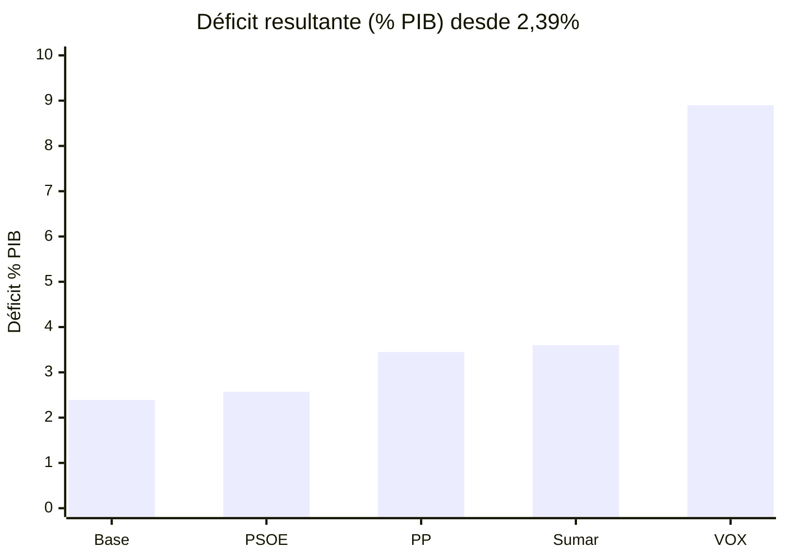

# Qué pasaría en España si se aplicaran todas las propuestas económicas de VOX, PSOE, PP y Sumar

> Simulador economía España 2026: programas VOX, PSOE, PP, Sumar comparados con la misma base (PIB, déficit, deuda, IRPF, IVA, pensiones, SMI, paro). Con scripts Python reproducibles y fuentes oficiales.

**Resultado en 10 segundos:** PSOE 2,6%→1,8% | PP 3,3-3,6% | Sumar 3,0-3,7% | VOX 7,6-8,9% (IRPF corregido a 85B, Hacienda 13-10-2026). El detalle por sueldo, vivienda y pensiones está abajo.

## Índice
- [Contenido y cómo reproducir](#contenido)
- [1. Qué propone cada uno](#1-qué-propone-cada-uno-resumen-fiel-fuentes-en-cada-01_propuestas_)
- [2. Resultado comparado](#2-resultado-si-se-aplicara-todo-de-cada-uno-año-1-estático--ajuste-dinámico-1-3-años)
- [3. Según tu prioridad](#3-según-tu-prioridad-elige-2-y-mira-su-fila)
- [4. Riesgo país](#4-riesgo-de-quiebra-del-país-lo-que-dicen-los-números)
- [5. Por salario](#5-cómo-te-afecta-según-tu-salario-bruto-anual-jornada-completa-sin-hijos-salvo-indicado)
- [6. Derechos e igualdad](#6-derechos-e-igualdad-qué-cambia-más-allá-del-dinero)
- [Fuentes y metodología](comparativa/02_metodologia_y_fuentes.md)
- [Sostenibilidad deuda 2026-30 con escenarios](comparativa/03_sostenibilidad_deuda.md)
- [Monte Carlo 10.000 iteraciones](comparativa/05_montecarlo_resultados.md)

## Contenido

| Carpeta | Propuestas | Simulación | Script |
|---|---|---|---|
| `vox/` | [01_propuestas_vox.md](vox/01_propuestas_vox.md) | [02_simulacion_vox.md](vox/02_simulacion_vox.md) | `03_vox_simulacion.py` |
| `psoe/` | [01_propuestas_psoe.md](psoe/01_propuestas_psoe.md) | [02_simulacion_psoe.md](psoe/02_simulacion_psoe.md) | `03_psoe_simulacion.py` |
| `pp/` | [01_propuestas_pp.md](pp/01_propuestas_pp.md) | [02_simulacion_pp.md](pp/02_simulacion_pp.md) | `03_pp_simulacion.py` |
| `sumar/` | [01_propuestas_sumar.md](sumar/01_propuestas_sumar.md) | [02_simulacion_sumar.md](sumar/02_simulacion_sumar.md) | `03_sumar_simulacion.py` |
| `comparativa/` | [00_baseline_INE.md](comparativa/00_baseline_INE.md) | [01_comparativa_global.md](comparativa/01_comparativa_global.md) | [02_metodologia_y_fuentes.md](comparativa/02_metodologia_y_fuentes.md) |
| `comparativa/` | [03_sostenibilidad_deuda.md](comparativa/03_sostenibilidad_deuda.md) | escenarios 2026-30 por partido | `04_deuda_sostenibilidad.py` |
| `comparativa/` | [05_montecarlo_resultados.md](comparativa/05_montecarlo_resultados.md) | Monte Carlo 10.000 iter. × 4 años | `05_montecarlo.py` |

Para reproducir: `python vox/03_vox_simulacion.py`, y lo mismo con los otros tres. Deuda: `python comparativa/04_deuda_sostenibilidad.py`. Solo usan la librería estándar.

## 0. Punto de partida común (para no comparar peras con manzanas)

- PIB 2025 (avance INE CNA 18/09/2026): **1.690.012 M€**, 34.365 € per cápita. Crecimiento: 2,4% (2023), 3,7% (2024), 2,6% (2025).
- Deuda pública (BdE): **100,7% PIB (~1.702 mm)**. Déficit (Hacienda/IGAE): **2,39% (40.330 M con DANA), 2,18% sin DANA**. En 2024: 3,15% con DANA / 2,80% sin DANA.
- Ingresos tributarios caja AEAT 2024: **294.734 M** (IRPF 129.408 M, IVA 90.541 M, Sociedades 39.096 M, Especiales 22.128 M). Cotizaciones: **199.595 M**. Gasto total: **725.001 M (45,5% PIB)**.
- Pensiones: nómina 12.974 M/mes, 10,28 M pensiones, media sistema 1.261,9 €/mes, gasto anual ~189.600 M. Revalorizaciones: +8,5% (2023), +3,8% (2024), +2,8% (2025), +2,7% (2026).
- Salario medio EAES 2024: **29.540 €** (mediana 24.497 €, modal 16.520 €). SMI: 15.876 € (2024), 16.576 € (2025), 17.094 € (2026, 1.221×14). IPC medio 2,8% (2024), 2,7% (2025). EPA Q4-2024: 21,86 M ocupados, paro 10,61%. Q4-2025: 22,46 M ocupados, paro ~9,93%.
- Regla útil: **1.000 M€ = 0,059% del PIB**. Todo el informe usa esta conversión.

Detalle y URLs oficiales en `comparativa/00_baseline_INE.md`.

## 1. Qué propone cada uno (resumen fiel, fuentes en cada `01_propuestas_*`)

**VOX** (Programa 23J + Hexágono oct-2025 + PNLs 2024-2026): IRPF a 2 tramos 15%/25% con exento 22.000 € y -4 pp por hijo; IVA 21→18 y 10→8, 0% alimentos básicos, 4% luz/gas/agua; Sociedades 25→15%; suprimir Patrimonio, Sucesiones, Plusvalía municipal y rebajar ITP 8→4% y AJD 1,5→0,5%; exención IRPF pensiones contributivas; cuota autónomos 0 si <SMI; bonificación 100%/50% Seguridad Social nuevos indefinidos; ahorro 40.000 M/año (22→12 ministerios, fin subvenciones/ODS/cooperación/TVs autonómicas); devolver Educación/Sanidad/Justicia al Estado; nuclear + fin ecotasas; derogar Ley Vivienda, desalojo <24h, fin IVA primera vivienda; prioridad nacional 10/5 años empadronamiento para ayudas/vivienda.

**PSOE** (Programa 23J + Gobierno 2024-2026, BOE/Moncloa): déficit a 1,8% en 2027 sin subida general; IRPF: mínimo exento en SMI + tramo ahorro >300k al 30%; IVA alimentos 0-2% transitorio + aceite oliva 4% permanente; Sociedades mínimo 15% grupos >750 M + rebaja pymes; banca (impuesto margen) y energéticas (gravamen 2025) permanentes; SMI 1.221×14 exento IRPF; pensiones +2,7% (+7%/+11,4% mínimas); subsidio 570/540/480 € + complemento empleo; vivienda: Ley 12/2023 + Plan 7.000 M 2026-2030 + aval ICO 20-25% + Bono Joven 250×24; jornada 40→37,5h sin recorte; PRTR 77.000 M ejecutados (76% MRR).

**PP** (Programa 23J 365 medidas + Ponencia jul-2025 + Plan Choque sep-2026 + Decálogo): deflactar IRPF <40.000 € + duplicar mínimos hijos (2.400→4.800 1º, hasta 9.000 4º+); IVA 0% básicos + energía 21→10% + exención IVA autónomos <85k + IVA 4% vivienda joven; IS pymes simplificado + umbral 250 = nuevos 50 + I+D; eliminar Grandes Fortunas/Patrimonio + ITP 4% + AJD 0,4%; SMI en diálogo social sin cifra; Tarifa 0 autónomos + menos declaraciones; pensiones en Pacto Toledo; 1 M viviendas en 4 años (250k/año) + derogar Ley Vivienda + antiokupación 24h + aval 95-100% jóvenes; nuclear prorrogada + quitar impuesto generación; Pacto Agua; 1 norma nueva = suprimir 3.

**Sumar** (Programa 23J + Acuerdo coalición + paquete +26.803 M + pacto fiscal nov-2024 + gravamen 50 M): reforma hasta 46% PIB; IRPF marginal 52% desde 300k + capital hasta 33%; Sociedades 15% efectivo duro + fin SICAV/SOCIMI/consolidación + límite pérdidas 4 años (+13.000 M); herencias desde 1 M + exento Fortunas 3→1 M (+2.500 M con IRPF); IVA 21% turístico + fin exención privada (+2.695 M); gravamen 3% patrimonio >50 M (~1.500 contrib., ~4.200 M) para infancia; SMI sobre IPC; jornada 37,5h en 2025 hacia 32h; mínimas sobre IPC; vivienda 1% PIB 10 años (>2 M protegidas) + topes + SOCIMI condicionadas; banco público ICO+Correos; herencia universal 20.000 € a los 23 + crianza universal 200 €/mes <18 años.

Prensa usada solo cuando es doble/triple y marcada como tal. Todo lo demás es PDF oficial, BOE o Moncloa.

## 2. Resultado si se aplicara TODO de cada uno (año 1 estático + ajuste dinámico 1-3 años)

|  | VOX | PP | PSOE | Sumar |
|---|---|---|---|---|
| Ingresos / merma bruta | -149,4B (-8,84% PIB) | -27,0B (-1,60%) | +5,0B (+0,30%) | +31,0B teórico (+1,83%), +20-22B real (+1,2-1,3%) |
| Ahorro / gasto nuevo | -40B ahorro prometido | -7B ahorro burocracia | +8B gasto | +41,5B gasto (16,9 vivienda + 15,6 crianza + 9,0 herencia) |
| Neto fiscal | +109,4B estático (+6,48pp) / +88,5B dinámico (+5,24pp) | +20B (+1,18pp) / +16,2B (+0,96pp) | +2,6-3B (+0,15-0,18pp) | +10,5B estático (+0,62pp) / +19,6-21,3B real (+1,16-1,26pp) |
| Déficit resultante | 7,6-8,9% (10%+ si ahorro solo 12-18B realista) | 3,3-3,6% | ~2,6% año 1 → 1,8% en 2027 | 3,0-3,7% (4%+ si crianza+herencia universales plenas) |
| Deuda 1-2 años | 108-113% y subiendo ~4pp/año | 101-102% estable | 99-100% bajando por PIB nominal | 102-104% y subiendo |
| PIB corto | +2,8pp impulso, luego riesgo tipos/EDP | +0,6-0,8pp | +2,2-2,6% base PRTR | +0,5pp consumo año 1, -0,5-1pp medio por inversión |
| Paro | 8-8,5% si se financia, rebote si crisis deuda | 8,8-9,0% (+350-450k ocupados) | 8,8-9,5% (más lento por jornada) | 10,5-11% en pymes, más empleo protegido |
| IPC | -0,8-1,2pp por IVA/energía | -0,4-0,6pp | 2,5-2,8% | +0,3-0,5pp por costes |

Cálculos en `vox/03_vox_simulacion.py` y equivalentes. Multiplicadores AIReF/BdE: bajada impuestos 0,4-0,6, recorte gasto 0,6-0,8, subida capital 0,2-0,4 con erosión 30-40%, gasto social 0,6-1,0. Recuperación parcial 15-20% merma en 2 años.

## 3. Según tu prioridad (elige 2 y mira su fila)

- **Pagar menos impuestos ya:** VOX (mucho menos, mucho déficit) > PP (bastante menos, déficit medio) > PSOE (igual) > Sumar (más si eres capital/alto).
- **Déficit y deuda bajo control UE:** PSOE (cumple) > PP (desvío manejable con senda) > Sumar (desvío estructural) > VOX (desvío masivo salvo tijera 40B creíble).
- **Llegar a fin de mes con hijos:** Sumar (crianza 2.400/año por hijo) > VOX (IRPF -8pp con 2 hijos + IVA) > PP (+1.500-2.000/año) > PSOE (+deducciones puntuales).
- **Comprar primera vivienda joven:** PP/VOX (entrada -40-50% por IVA/AJD/ITP + aval) > PSOE (aval 20% + bono) > Sumar (más alquiler protegido futuro, compra privada más gravada).
- **Alquilar en zona tensionada:** Sumar (tope + más oferta pública a 3-5 años) > PSOE (tope + prórroga 2 años) > PP/VOX (más oferta privada por seguridad jurídica, sin tope inicial sube 3-5%).
- **Autónomo/pyme que contrata:** VOX/PP (cuota 0, bonif 100%, IS 15% o simplificado) > PSOE (Kit Digital, cuota por ingresos) > Sumar (más cuota efectiva y jornada).
- **Pensionista medio (~17.668 €/año, 14 pagas):** PSOE/Sumar (revalorización +2,7% garantizada +477 €/año + mínimas +7-11,4% (+800-1.400 €)) > PP (Pacto Toledo, sin cifra extra) > VOX (el pensionista medio ya no presenta IRPF —63% según Gestha—; umbral exento retenciones 15.876 €; paga retenciones bajas ~800-1.000 €/año que se eliminan, pero lejos de +2.000; solo el ~37% con pensión >22.000 € ahorra ~4.160 €/año de media; sistema pierde 14,3B AEAT + 9,4B cotizaciones = ~24B/año). Para pensión alta (>22.000 €): VOX > PSOE/Sumar > PP.
- **Desigualdad baja:** Sumar (Gini -2-3pp) > PSOE (-0,5-1pp) > PP (neutro) > VOX (sube inicial por tipo plano).

## 4. Riesgo de quiebra del país: lo que dicen los números

España no quiebra como una empresa (deuda en euros, BCE como prestamista de última instancia, TPI/antifragmentación desde 2022, vencimiento medio ~8 años, base inversora amplia). El riesgo real es otro: **quedarse sin margen fiscal, entrar en Procedimiento de Déficit Excesivo, pagar más intereses y tener que recortar/subir impuestos en la siguiente recesión**. Referencia: 2012 (prima +600 pb sin BCE) vs 2024-2026 (prima 70-90 pb con BCE).

- **PSOE:** necesidades de financiación estables. Con PIB nominal +5-6% la deuda baja sola 2-3pp/año. Riesgo de tensión bajo salvo shock externo. Procedimiento excesivo evitable.
- **PP:** +16-20B neto (+1pp). Financiable con crecimiento +2,5% y senda a 2,5% en 2 años. Prima +20-40 pb. Sin EDP duro si hay presupuestos.
- **Sumar:** +20B neto estructural (+1,2pp) + derechos permanentes (crianza+herencia 24,6B/año). Si se consolidan, el déficit no baja del 3,5-4% ni creciendo. Prima +40-80 pb, EDP probable, dependencia de que la UE acepte 40-46% presión fiscal. No es impago, es ajuste futuro (más impuestos o menos inversión).
- **VOX:** +89-109B neto (+5,2-6,5pp) o +134B si el ahorro se queda en 15B. Eso es volver a 2010-2012 en saldo pero con deuda 100% y BCE menos acomodaticio. Prima +80-150 pb, EDP seguro, riesgo de congelar fondos UE si hay ruptura verde/autonómica. Financiable 12 meses por colchón Tesoro, insostenible a 2-3 años sin ejecutar la tijera o revertir parte de la rebaja. Tampoco es impago inminente, es pérdida de escudo ante la próxima crisis.

Ningún escenario da impago a 12 meses con BCE activo. La diferencia es el colchón que te queda para la siguiente recesión: PSOE/PP lo mantienen, Sumar lo estrecha, VOX lo agota salvo recorte equivalente.

## 5. Cómo te afecta según tu salario (bruto anual, jornada completa, sin hijos salvo indicado)

Base: salario medio 29.540 €, mediana 24.497 €, SMI 16.576 € (2025). Cálculos orientativos con tipos efectivos 2024.

**Hasta SMI (~16.500 €, ~2,5 M personas + parciales):**
- VOX: IRPF ~0€ (ya exento: reducción trabajo 7.302€ + mínimo personal 5.550€ + deducción SMI 590,89€ RDL 5/2026 → base ~1.650€, cuota ~35€, con deducción SMI → ~0€; VOX lo pone a 0€ pero ya estaba ~0€; confirmado por sueldovox.es y Hacienda "SMI=0€ ahorro"). Solo IVA: cesta -3-4% = **+400-600 €/año**. Si autónomo <SMI: +3.000-3.500 € por cuota 0.
- PP: deflactación + IVA 0% básicos + energía 10%. IRPF ~0€ (ya exento). **+200-400 €/año** (solo IVA).
- PSOE: SMI a 17.094 exento + subsidio/IMV mejorado si parcial/paro. Ganas **+518 € salario + 300-500 € fiscal/social**.
- Sumar: SMI sobre IPC + crianza si hijos (2.400 por hijo) + alquiler topado. Sin hijos: **+300-500 €**, con 2 hijos: **+5.000-5.500 €**.

**16.500-22.000 € (mileurista bajo, ~3 M):**
- VOX: IRPF 0-400€ (exento o casi; sueldovox.es muestra 0€ hasta ~18-19k, luego ahorro pequeño al llegar a 22k) + IVA 400-600€. Total **+400-1.000 €**.
- PP: **+400-700 €** (deflact + hijos + IVA).
- PSOE: **+400-700 €** (reducción trabajo 7.302 € + ayudas).
- Sumar: sin hijos **+200-400 €** (SMI arrastra), con hijos **+3.000-5.000 €**.

**22.000-30.000 € (mediana, el grueso):**
- VOX: del 25-30% al 15% (-10-15pp). Soltero: **+1.800-3.000 €**. Con 2 hijos (-8pp → 7%): **+3.500-4.500 €**.
- PP: deflact + mínimos x2. Soltero **+400-700 €**, 2 hijos **+1.500-2.000 €**.
- PSOE: deducciones crianza/vivienda puntuales. **+300-600 €**, más si alquiler con deducción 1.000 €.
- Sumar: IRPF igual o +0-200 € (tramos altos no te tocan), pero cesta +1-2% por costes. Sin hijos **-100 a +200 €**, con 2 hijos **+4.500-5.000 €** por crianza.

**30.000-45.000 € (técnicos, ~25% asalariados):**
- VOX: **+2.500-4.500 €** (soltero arriba, con hijos más).
- PP: **+800-1.500 €** con hijos, +400-700 sin hijos.
- PSOE: **+200-500 €**.
- Sumar: **-200 a +300 €** sin hijos (IVA privado/ambiental te toca), **+3.000-4.500 €** con hijos.

**45.000-70.000 €:**
- VOX: al 15% hasta 70k. **+4.000-7.000 €**.
- PP: **+600-1.200 €**.
- PSOE: neutro.
- Sumar: ahorro 6-50k 21→23% y 50-70k 23→26% si ahorras. **-300 a -1.000 €** sin hijos, compensado solo con hijos.

**70.000-150.000 €:**
- VOX: 15% hasta 70k + 25% desde. **+6.000-10.000 €**.
- PP: deflact parcial + Patrimonio fuera. **+1.000-2.500 €**.
- PSOE: ahorro >300k no te toca aún, Sociedades mínimo si empresario. **-0-500 €**.
- Sumar: IRPF + tramos 120k+ y capital 26-30%. **-1.500 a -5.000 €/año** según ahorro/dividendos. Herencias 1 M+: +200k vs CCAA bonificadas.

**>150.000 € / >300k ahorro / >1 M patrimonio / >50 M:**
- VOX: máximo ahorro (Soc 15%, sin Patrimonio/Sucesiones). **+20.000-100.000 €+**.
- PP: alto ahorro (sin Fortunas/Patrimonio, Sucesiones mínimas). **+10.000-40.000 €**.
- PSOE: +2pp ahorro >300k + banca/energéticas si accionista. **-2.000 a -15.000 €**.
- Sumar: 52% desde 300k + capital 30-33% + Sucesiones estatal + 3% >50 M. **-15.000 a -500.000 €+** (ej. 5 M herencia: >1,5 M cuota; 10 M: ~3,3 M). Aquí se concentra el +20B.

**Pensionistas (media 1.262 €/mes = 17.668 €/año con 14 pagas):**
- VOX: exención IRPF pensiones. Coste agregado **14,3B** (AEAT 2024: retenciones pensiones públicas 14.317 M€). La media aritmética por pensionista (~1.540 €) caería en el rango +1.200-2.000, **pero es engañosa**: el 63% no presenta declaración (Gestha); umbral exento retenciones = 15.876 €/año; el pensionista medio (17.668 €/año) paga retenciones bajas (~800-1.000 €/año est.) que se eliminan. El ahorro real se concentra en el ~37% con pensión >22.000 € (~4.160 €/año de media). Sistema -14,3B IRPF + 9,4B cotizaciones bonificadas = **~24B/año**. Capitalización sueca a 20-30 años. Fuente: AEAT Nota3_Pensiones, Gestha, demon.code.blog/2020/05/07/pensiones.
- PSOE/Sumar: +2,7% (+477 €/año media sobre 17.668 €) + mínimas +7-11,4% (+800-1.400 €). Sostenible con MEI/cuotas.
- PP: revalorización Pacto Toledo sin extra cifrado.

**Jóvenes <35 que compran (piso 200-250k):**
- VOX/PP: fin IVA o 4% + ITP 4% + AJD 0,4% + aval 95-100%. Ahorro fiscal **20.000-30.000 €** + entrada de 50k a 25k.
- PSOE: aval 20-25% + cuenta 2.000/año exenta. Ahorro **8.000-12.000 €**.
- Sumar: más alquiler protegido, compra privada con más carga y reserva 30%.

**Inquilinos tensión (30-50% esfuerzo):**
- PSOE/Sumar: tope + prórroga + deducción 1.000 €. Esfuerzo -3-6pp.
- PP/VOX: sin tope, más oferta privada 8-12% a 2 años por seguridad jurídica. Año 1 alquiler +3-5%, luego modera.

## 6. Derechos e igualdad (qué cambia más allá del dinero)

- **Género:** brecha salarial 83,9% (26.905 € vs 32.058 €, INE EAES). SMI/mínimas/crianza (PSOE/Sumar) la cierran 1-2pp por abajo; techo 52% + transparencia no la mueven arriba. VOX/PP mejoran neto familiar con hijos pero no brecha horaria/parcialidad. Complemento brecha 36,90 €/mes e IMV se mantienen en PSOE/PP/Sumar, en riesgo en VOX si recorta no contributivas sin arraigo.
- **Infancia:** pobreza infantil ~28% AROPE. Crianza 200/mes (Sumar) -6-9pp, el mayor efecto. VOX/PP (-4pp por hijo / mínimos x2) -2-4pp vía IRPF (solo si declaran). PSOE (complemento IMV + maternidad) -1-2pp.
- **Jóvenes:** herencia 20k a los 23 (Sumar) iguala punto de partida pero universal (también ricos). Hucha/aval (PP/PSOE) solo si compran. Cuota 0 (VOX/PP) facilita autónomo. Jornada 32-37,5h (PSOE/Sumar) ayuda conciliar pero destruye parcial juvenil hostel si sin productividad.
- **Mayores/dependencia:** exención pensiones (VOX) solo beneficia a quien ya tributa (>15.876 €/año, ~37% sobre todo >22.000 €: +1.200-4.160 €/año según nivel); el jubilado medio (17.668 €/año) paga retenciones bajas (~800-1.000 €/año est.) que se eliminan, pero el 63% no presenta IRPF y no nota cambio (Gestha); mínimas +11,4% (PSOE/Sumar) +5-9% renta mínima. Capitalización sueca (VOX) a 20-30 años, nada año 1-5.
- **Territorio:** VOX recentraliza (1 Gobierno/1 Parlamento objetivo, devolver Educación/Sanidad) = ahorro potencial grande pero 2-4 años litigio y parálisis CCAA; PP reforma financiación + suficiencia; PSOE +30.000 M extra + nuevo sistema; Sumar 1% PIB + Sareb/SEPES recentraliza vivienda. España vaciada: banco Correos (Sumar) vs bonif ITP/IBI rural (PP) vs prioridad nacional (VOX).
- **Migración:** ~2,8 M afiliados extranjeros sostienen cotizaciones 4-6B. VOX (expulsión + excluir no contributivas + 10/5 años) ahorra 3-6B según VOX pero pierde cotizantes y choca con Constitución/UE/CEDH (2-4 años tribunales). PSOE/PP/Sumar mantienen cotización como vía (subsidio con arraigo laboral, pasarela IMV).
- **Vivienda como derecho:** PSOE/Sumar (20% público, irreversible, tanteo, registro vacías) lo hacen exigible a 5-10 años; PP/VOX (propiedad + seguridad jurídica + suelo) aumentan oferta privada más rápido pero sin garantía social. Ninguno da casa año 1: déficit 100-150k/año (BdE).
- **Trabajo:** SMI 60% salario medio ya en PSOE (1.221 €), PP lo deja a diálogo, Sumar sobre IPC, VOX sin cifra. Jornada: 37,5h (PSOE/Sumar, ley) vs flexibilidad/bancos horas (PP/VOX). Desconexión/registro en PSOE/Sumar, derecho al error/TEA en PP/VOX.

## 7. Vivienda, empleo, pensiones y energía en una página

- **Vivienda:** se visan 110-130k y se terminan ~90k. Faltan 100-150k/año. PSOE (30-40k/año públicas) y PP (140-170k reales vs 250k promesa) moderan +1-3%. VOX igual si liberaliza suelo de verdad (+5-8% si no). Solo Sumar (150-200k protegidas con 16,9B/año) cerraría, a 3-5 años y recentralizando.
- **Empleo:** 22,46 M ocupados, temporalidad 16%. PP/VOX crean 350-500k indefinidos vía coste (-6-9%) si no suben tipos. PSOE mantiene pero jornada resta 0,3-0,6% en pymes. Sumar destruye 0,5-1pp en pymes mano intensiva y crea protegido/público. Paro 8% solo con VOX/PP financiados o PSOE con productividad; 11% si Sumar sin matices o VOX con crisis deuda.
- **Pensiones:** +5,1B por cada +2,7%. Todos revalorizan. Nadie lo financia sin MEI 0,9% + cuotas + inmigración + empleo. VOX -24B (IRPF 14,3B AEAT + bonif 9,4B), Sumar +mínimas sin base, PP fía a empleo, PSOE a cotizaciones. Hucha 130.000 M (PSOE) vs capitalización (VOX) son a 10-30 años.
- **Energía:** factura -8-25% con VOX (4% + sin IVPE + nuclear) y -8-12% con PP (10% + sin generación + nuclear CSN). PSOE baja gradual sin rebote. Sumar tarifa verde 4/10/21% + fiscalidad ambiental (+0,3pp IPC). Ruptura verde VOX arriesga PRTR; PP es compatible.

## 8. Cómo leer los números sin que te engañen

- Son rangos año 1-3, no predicción oficial (±20-30%). Si alguien te da un decimal, desconfía.
- El PIB nominal +5-6% baja la deuda sola 2-3pp/año. Mira déficit estructural, no solo deuda.
- La merma VOX 135-149B (IRPF corregido a 85B, Hacienda 13-10-2026) y el gasto Sumar 41,5B son brutos. El neto dinámico (VOX +89B, Sumar +20B, PP +16B, PSOE +3B) ya descuenta más consumo/empleo y erosión.
- Pregunta siempre: ¿con qué se paga? Si no hay partida PGE línea a línea (ahorro 40B VOX, 1% vivienda Sumar), es promesa a 3-5 años, no año 1.
- Actualiza con INE cada trimestre: CNA (PIB), EPA (paro), IPC (cesta), EAES/EACL (salarios/coste), IGAE (déficit), AEAT (recaudación por figura), ECV (Gini/AROPE).

## 9. Fuentes (todas oficiales salvo aviso)

### Organismos oficiales (datos baseline y verificación)
- **INE** — PIB CNA2025 (1.690.012 M€), EAES2024 (salario medio 29.540,26 €), EPA Q4-2024/2025 (paro, ocupados). https://www.ine.es/dyngs/Prensa/CNA2025.htm · https://www.ine.es/dyngs/Prensa/EAES2024.htm · https://www.ine.es/dyngs/Prensa/es/EPA4T24.htm
- **AEAT** — Informe Anual Recaudación Tributaria 2024: total 294.734 M€, IRPF 129.408 M€, IVA 90.541 M€, Sociedades 39.096 M€, Especiales 22.128 M€. Nota3_Pensiones: retenciones pensiones públicas 14.317 M€. https://sede.agenciatributaria.gob.es/static_files/AEAT/Estudios/Estadisticas/Informes_Estadisticos/Informes_Anuales_de_Recaudacion_Tributaria/Ejercicio_2024/IART24_es_es.pdf
- **Banco de España** — Deuda pública 100,7% PIB (~1.702 mm). https://www.bde.es
- **IGAE/Hacienda** — Déficit 2,39% (40.330 M con DANA), 2,18% sin DANA. https://www.igae.pap.hacienda.gob.es
- **Ministerio de Hacienda** — Coste IRPF VOX = 85.000 M€ (61% recaudación IRPF ~140B). Ministro Arcadi España, Consejo de Ministros 13-10-2026. SMI=0€ ahorro, 100k=18.935€, 1M=212.333€. Fuentes: Infobae, El Independiente, EFE (13-10-2026).
- **La Moncloa** — Revalorización pensiones +2,7% general, +7% mínimas, +11,4% con cónyuge (10-02-2026). SMI 1.221×14 = 17.094 € (2026). https://www.lamoncloa.gob.es
- **BOE** — RDL 4/2024, Ley 7/2024, RD SMI/pensiones/subsidio/vivienda. https://www.boe.es
- **Seguridad Social** — Pensiones: nómina 12.974 M/mes, 10,28 M pensiones, media 1.261,9 €/mes, gasto anual ~189.600 M. https://www.seg-social.es

### Programas electorales (PDF oficiales)
- VOX: `votaabascal.es/assets/pdf/Programa-VOX-2023.pdf` + `voxespana.es/wp-content/uploads/2025/10/Programa-WEB-021025.pdf`
- PSOE: `psoe.es/media-content/2023/07/PROGRAMA_ELECTORAL-GENERALES-2023.pdf`
- PP: `pp.es/wp-content/uploads/2023/07/programa_electoral_pp_23j_feijoo_2023.pdf` + `pp.es/wp-content/uploads/2025/07/POLITICA_PARTIDOPOPULAR_2025.pdf`
- Sumar: `movimientosumar.es/wp-content/uploads/2023/07/Un-Programa-para-ti.pdf` + BOCG `congreso.es/public_oficiales/L15/CONG/BOCG/B/BOCG-15-B-335-1.PDF`

### Verificación y anti-desinformación
- **Gestha** (Técnicos del Ministerio de Hacienda) — 63% de pensionistas no presenta IRPF; umbral exento retenciones 15.876 €/año (=SMI 2024); obligación declarar 22.000 € (1 pagador). https://www.gestha.es
- **Newtral** — Fact-checking: VOX 2019 programa "15% Sociedades solo para PYMES"; verificación propuestas. https://www.newtral.es
- **demon.code.blog** — "Desmontando a VOX: pensiones" (07-05-2020). Aclaró que la mayoría de pensionistas no notaría cambio en IRPF: "la mayoría de la gente no va a notar ningún cambio". Clave para corregir el claim engañoso VOX "+1.200-2.000€/año sin IRPF". https://demon.code.blog/2020/05/07/pensiones/
- **SmartVote** — Estudio: VOX identificada como "mayor fábrica de bulos" entre partidos políticos españoles.
- **Institut Ostrom** (think tank liberal) — Cuentas de VOX "tramposas" (oct-2026): "Bajar impuestos puede ser buena política. Pero prometer que lo pagarán las subvenciones es tramposo."
- **Alex Wong** (alexpwong.substack.com) — Análisis independiente: VOX IRPF+IVA = ~118B (vs 64-70B declarado por VOX); solo ~15.227 M€ en recortes concretos identificados; infografía VOX muestra IRPF 85B.
- **sueldovox.es** — Simulador oficial de VOX (programa económico junio 2025). Confirma que con SMI el ahorro de IRPF es 0€ (ya exento por reducciones actuales). Metodología transparente: detalla reducciones, mínimos y deducciones del sistema actual vs propuesta VOX. https://www.sueldovox.es/

### Prensa (solo cuando doble/triple fuente y marcada)
- **Cinco Días/El País** (21-07-2023) — Propuesta IRPF VOX "hundiría la recaudación en un 50%" (~65B).
- **Herqles** (10-10-2026) — VOX estima 64B (IRPF 40B + IVA 14B + Soc 10B); confirma Sociedades 15% general.
- **Infobae, El Independiente, EFE** (13-10-2026) — Hacienda cifra IRPF VOX en 85B (61% recaudación).
- **El País, El Economista, Europa Press, Infobae, La Voz de Galicia, El Mundo** — Gravamen 3% >50M Sumar (~4.200 M recaudación).
- **EFE** (29-06-2025) — VOX propone "rebajas masivas al Impuesto de Sociedades".
- PP IVA 4% vivienda joven + IRPF jóvenes: confirmado por pp.es + Congreso moción + 6+ periódicos de todo el espectro ideológico.

Prensa usada solo cuando es doble/triple y marcada como tal. Todo lo demás es PDF oficial, BOE, Moncloa o AEAT.

## 10. Límites

No es modelo DSGE ni microdatos AEAT. No incluye tipos BCE, petróleo, guerra, DANA o UE fuera de lo anunciado. No mezcla partidos (son incompatibles en Sociedades, jornada, vivienda). Si se combinan (coalición), el resultado está entre los dos, no es la suma.

---

Metodología completa en `comparativa/02_metodologia_y_fuentes.md`. Comparativa corta en `comparativa/01_comparativa_global.md`.
